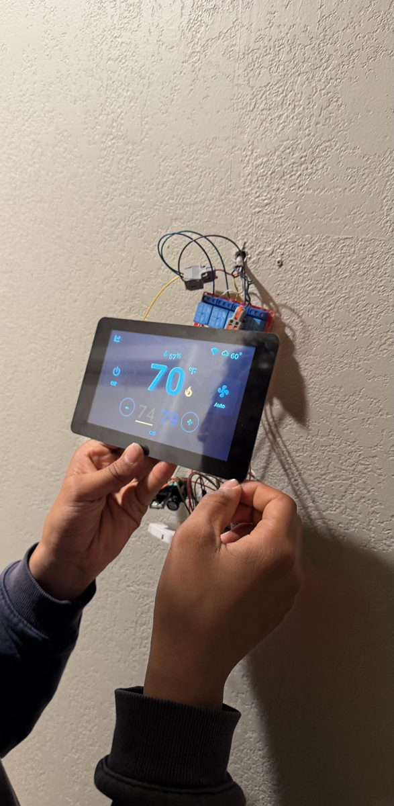
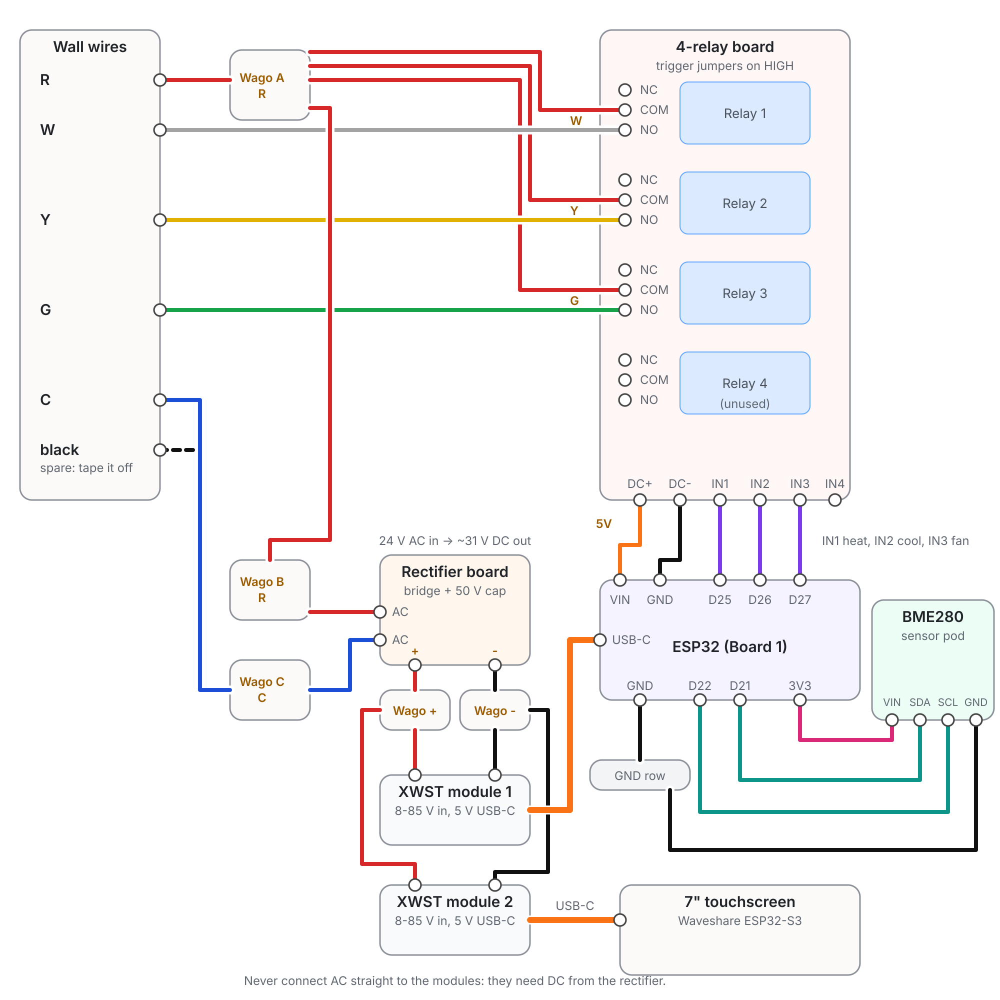

# DIY Smart Thermostat

A home-built replacement for a White-Rodgers wall thermostat. It uses two ESP32 boards, a 7-inch touchscreen, Home Assistant and Google voice control, and runs a Carrier gas furnace and central AC. It's powered entirely from the furnace's own 24 V, with no batteries and no wall plug.



## Features

- **Separate heat and cool setpoints.** Each mode remembers its own target.
- **Safety shutoffs on the controller board.** It turns everything off if the sensor stops reporting, the room passes 85 °F while heating or drops below 55 °F while cooling, or the furnace runs for more than 2 hours. These work even if the server is down.
- **Smart pre-heat.** It learns how fast the house warms up and starts early, so the room is warm by a set time.
- **Energy and cost tracking.** Heating and AC cost per day, week and month, plus the whole-house electric bill.
- **Living standby screen.** A clock, weather and a 3-day forecast, with animated rain, storms, snow and sun, holiday themes, and an orange or blue glow while the furnace or AC runs.
- **7-day forecast page** with hourly temperature and rain.
- **Network page** with WiFi signal and an internet speed test.
- **Room averaging.** Choose the wall sensor, a Bluetooth sensor in another room, or the average of both.
- **Air filter reminder** based on real blower hours.
- **Wireless updates.** Both boards get new code over WiFi.
- **Voice and phone control** through Google Assistant and the Home Assistant app.

## How it works

```
Furnace (24 V AC) ──► Board 1: ESP32 + relays + BME280 ◄──► Home Assistant ◄──► Board 2: 7" touchscreen
                          (makes all heating/cooling decisions)   (weather, costs, voice)    (the wall interface)
```

Board 1 controls the furnace by itself. Home Assistant and the screen add the extras, so if either one goes down the house still stays warm.

## Wiring



| Wall wire | Goes to |
|---|---|
| **R** (24 V) | Wago → relay 1–3 COM terminals, and rectifier AC input |
| **C** (common) | Wago → rectifier AC input |
| **W** (heat) | Relay 1 NO (ESP32 D25) |
| **Y** (cool) | Relay 2 NO (ESP32 D26) |
| **G** (fan) | Relay 3 NO (ESP32 D27) |

**Power:** the rectifier board turns 24 V AC into about 31 V DC. Two step-down modules rated for 8–85 V input make 5 V over USB-C: one for the ESP32 and one for the display. The relay board gets 5 V from the ESP32's VIN pin. The BME280 is on I²C (SDA D21, SCL D22) and gets 3.3 V.

## Parts

| Part | Qty | Notes |
|---|---|---|
| ELEGOO ESP32 dev board (USB-C) | 1 | Board 1, the controller |
| 4-channel 5 V relay board | 1 | Trigger jumpers set to **HIGH** |
| BME280 sensor | 1 | Temperature, humidity and pressure |
| Waveshare ESP32-S3-Touch-LCD-7 | 1 | Board 2, the 7" 800 × 480 touchscreen |
| AC-DC rectifier filter board (1N4007 bridge, **50 V** 470 µF capacitor) | 1 | Check that the capacitor says 50 V |
| XWST XW-0885-5-15W-USB step-down module (8–85 V → 5 V 3 A USB-C) | 2 | One per board |
| Wago lever connectors | 5 | |
| Mini breadboard + jumper wires | 1 set | |
| Govee H5075 Bluetooth sensor | 1 | Optional, for room averaging |
| Computer or NAS running Home Assistant + ESPHome | 1 | |
| 3D-printed back box + front bezel | 1 | See `enclosure/` |
| M3 × 20 flat-head screws | 4 | Hold the bezel to the box |

### Parts that didn't work

Cheap **AC-input buck converters rated 8–32 V** failed. "24 V AC" thermostat power measured up to 28 V, which is about 38 V once it's turned into DC. Two of the converters failed, and the second one took the first touchscreen with it. **Use power modules rated for at least 55 V input, after a rectifier.** [Video of the failure](https://www.youtube.com/shorts/-Lq5AzpIsWE)

## Repository layout

```
esphome/
  board1-thermostat.yaml     controller: relays, sensor, safety, pre-heat, runtime counters
  board2-display.yaml        touchscreen UI (LVGL)
  secrets.yaml.example       copy to secrets.yaml and fill in
homeassistant/packages/
  heat_cost.yaml             heating / AC cost sensors and daily history
  display_forecast.yaml      3-day and 7-day forecast sensors for the screen
  heat_timers.yaml           timed heat helpers
enclosure/
  thermostat_back_box.scad   OpenSCAD: vented back box
  thermostat_front_bezel.scad OpenSCAD: bezel that clamps the screen
docs/                        wiring diagram (SVG + PNG)
photos/                      build photos
```

## Setup

1. **ESPHome:** copy `esphome/secrets.yaml.example` to `secrets.yaml` and fill in your WiFi details and keys. Flash each board over USB the first time; after that, updates go over WiFi.
2. **Home Assistant:** put the files from `homeassistant/packages/` in your `packages` folder, then restart. Add both boards through the ESPHome integration, and turn on **"Allow the device to perform Home Assistant actions"** for the display.
3. **Entity IDs:** the `substitutions:` block at the top of `board2-display.yaml` lists the Home Assistant entities the screen reads, such as your weather entity, utility bill sensors and room sensor. Change them to match yours.
4. **Enclosure:** open the `.scad` files in OpenSCAD, export STL, and print. Both parts print without supports.

## ⚠️ Safety

- Turn the furnace power **off** before touching thermostat wires, and never let R and C touch.
- These parts only connect to the **24 V thermostat wires**. Never connect any of them to 120 V mains.
- Check every voltage with a meter before plugging in a board.
- If you're not sure about something, ask an adult or an HVAC technician.

## Credits

Designed, wired and coded by **Vivaan Mishra**, with help from Claude (Anthropic's AI assistant).
Built with [ESPHome](https://esphome.io), [LVGL](https://lvgl.io), [Home Assistant](https://www.home-assistant.io) and [OpenSCAD](https://openscad.org).
